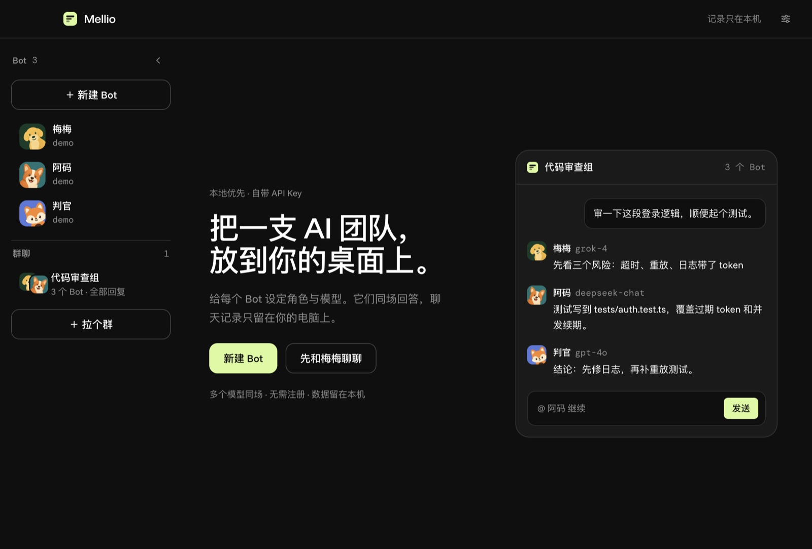
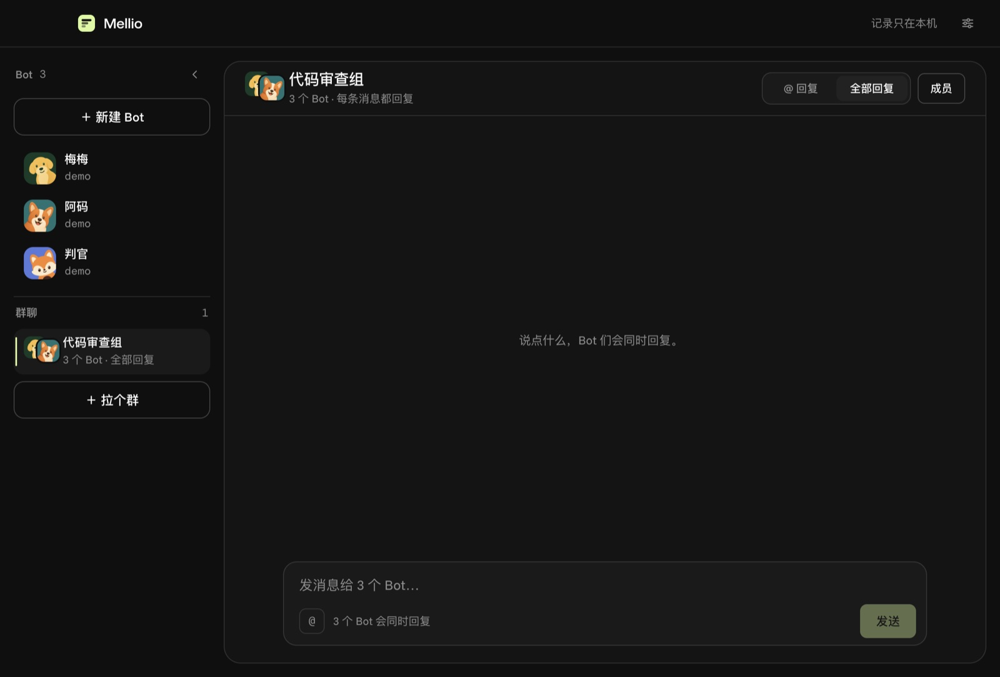
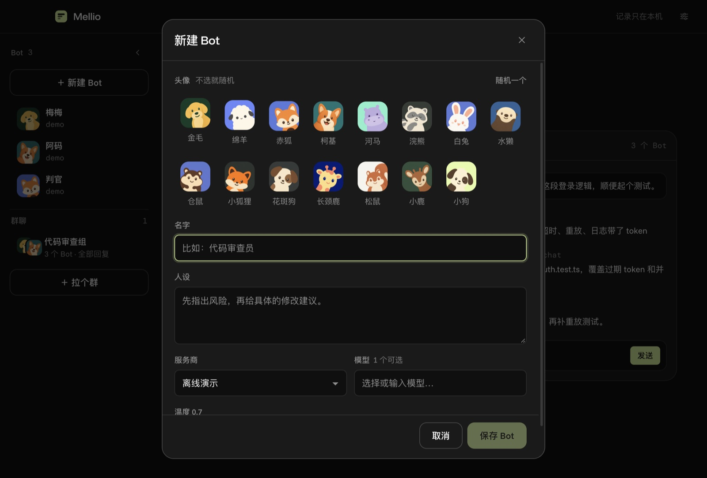
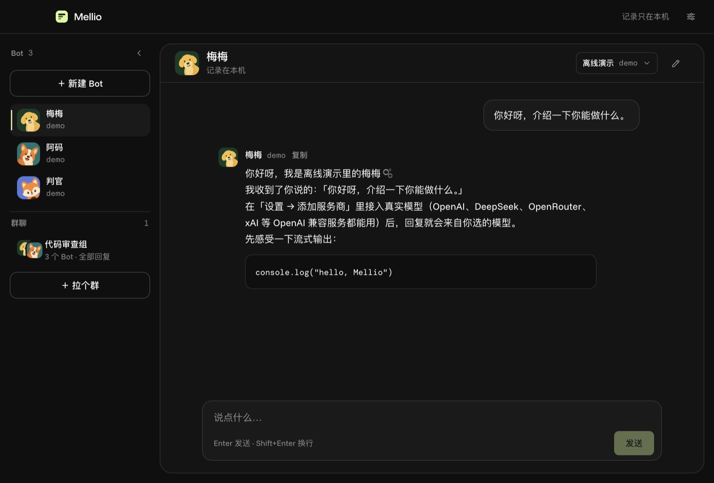

<p align="center">
  
</p>

<h1 align="center">Mellio</h1>

<p align="center"><strong>Your AI crew, your way.</strong><br>把你自己的 AI 团队，放到桌面上。</p>

<p align="center">
  <code>macOS 11+</code> · <code>Windows 10+</code> · <code>v0.1.0 Beta</code> · <code>本地优先</code> · <code>BYOK</code> · <code>无需注册</code>
</p>

Mellio 是一款本地优先的多 Bot AI 桌面工作空间。为每个 Bot 设定头像、人设、服务商和模型，让它们在同一个工作空间里单聊、群聊、互相补充。聊天记录默认保存在本机，模型调用使用你自己的 API Key。

它不提供模型算力，也不代管你的数据；你接入哪个供应商，请求就发送给谁。

---

## 目录

- [功能特性](#功能特性)
- [界面预览](#界面预览)
- [安装](#安装)
- [快速开始](#快速开始)
- [使用指南](#使用指南)
- [服务商与模型](#服务商与模型)
- [数据与隐私](#数据与隐私)
- [故障排查](#故障排查)
- [开发](#开发)
- [打包与发布](#打包与发布)
- [已知限制](#已知限制)
- [贡献与反馈](#贡献与反馈)
- [项目状态与许可证](#项目状态与许可证)

---

## 功能特性

### 多 Bot 工作空间
- 创建任意数量的 Bot，每个 Bot 有独立头像、名字、人设、服务商、模型和温度
- 15 个预设头像；创建时**不选就随机分配**
- 左侧是 Bot 名册，没有"会话列表"这一层：点 Bot 就是和它单聊
- 左侧栏可折叠，折叠状态会记住

### 1:1 对话
- 流式输出、随时停止、失败隔离、超时保护
- 用户消息立即显示，不需要等 Bot 生成完成
- 右上角可随时切换该 Bot 的服务商和模型，立即生效
- 每条 Bot 回复的头部有「复制」，直接写入系统剪贴板
- Markdown 渲染，代码块、列表、引用正常显示；不渲染原始 HTML

### 群聊协作
- 把 2 个以上 Bot 拉进一个群，群成员随时可改
- 两种回复模式：
  - **全部回复**：每条消息所有 Bot 都回复
  - **@ 回复**：只有被 `@` 点名的 Bot 回复
- 输入 `@` 或点输入框的 `@` 按钮打开点名面板，支持键盘 ↑ / ↓ / Enter / Esc
- 群名可自定义，留空自动用 Bot 名字生成
- 同一轮并行、独立状态（排队 / 生成中 / 失败 / 已取消）、可单独停止

### 模型自由
- 任何 OpenAI-compatible 服务：OpenAI、DeepSeek、xAI (Grok)、OpenRouter、Groq、Ollama、LM Studio 等
- 设置里一键**拉取模型列表**并缓存；创建 Bot、聊天页切换模型时直接选，不用手输模型 id
- API Key 用系统钥匙串加密保存，只在本机使用

### 本地优先
- SQLite 本地存储（WAL），无账号、无云端、无强制同步
- 旧版 `data.json` 首次启动自动迁移，原文件保留为 `data.json.imported`
- 数据库 schema 带版本迁移；旧头像 id 自动映射到新预设

### 细节
- GSAP 首屏与消息入场、@ 面板、头像选择、侧栏折叠等动效；遵循系统"减少动态效果"
- 深色界面、统一设计系统、自定义 App 图标
- 应用内不收集遥测；日志不记录 API Key

---

## 界面预览

| 群聊：两种回复模式与成员管理 | 15 个预设头像，不选随机 |
|---|---|
|  |  |



---

## 安装

### 系统要求

| 平台 | 版本 | 安装包 |
|---|---|---|
| macOS | 11 Big Sur 及以上 | DMG（当前为 Apple Silicon / arm64 构建） |
| Windows | 10 / 11 x64 | NSIS EXE（在 Windows 或 CI 上构建） |

运行时不依赖 Node.js、Python 或本地服务；所有运行时随安装包分发。

### 安装包位置

从项目的发布渠道下载对应安装包。源码构建产物位于 `release/`：

```text
release/Mellio-0.1.0-arm64.dmg
release/Mellio Setup 0.1.0.exe   # 需在 Windows / CI 上执行 npm run dist:win
```

### macOS

1. 打开 DMG，把 Mellio 拖进「应用程序」
2. 当前版本**未做 Apple 公证**，首次打开需要：
   - 在「应用程序」里右键 Mellio → 打开 → 再确认一次；或
   - 系统设置 → 隐私与安全性 → 仍要打开
3. 如果提示"已损坏"（通常是未签名/隔离属性导致），且你确认安装包来源可信：

```bash
xattr -dr com.apple.quarantine /Applications/Mellio.app
```

### Windows

1. 运行 NSIS 安装包；安装按当前用户进行，不需要管理员权限
2. 未签名版本会触发 SmartScreen：更多信息 → 仍要运行
3. 数据目录在 `%APPDATA%\Mellio\`

### 从源码运行

需要 Node.js 22+ 和 npm：

```bash
# 在项目根目录
npm install
npm run dev
```

---

## 快速开始

1. **启动**。首次打开会创建一个离线演示 Bot「梅梅」，不填 Key 也能体验流式输出、群聊和全部界面。
2. **添加服务商**。右上角设置 → 填名称、Base URL、API Key → 保存。
3. **拉取模型**。在服务商那一行点「拉取模型」，模型列表会缓存到本地。
4. **新建 Bot**。左栏「＋ 新建 Bot」：头像可以不选（自动随机），填名字、人设，选择服务商和模型。
5. **开始聊天**。点左侧 Bot 进入 1:1；或「＋ 拉个群」把多个 Bot 拉在一起。
6. **切换模型**。1:1 页面右上角显示当前服务商和模型，点开即可切换。

---

## 使用指南

### Bot 管理

- **新建 / 编辑 / 删除**：左栏「＋ 新建 Bot」；把鼠标移到 Bot 行上，右侧出现编辑按钮
- **头像**：15 个预设任选；不选就在保存时随机分配；「随机一个」可以立刻换一个
- **人设**：写进系统提示词，决定 Bot 的角色、语气和边界
- **温度**：0–2，默认 0.7；越低越稳定，越高越发散
- **保存后**：新建的 Bot 会自动打开它的 1:1 会话

### 1:1 对话

- 点左栏任意 Bot 即可打开；每个 Bot 只有一个固定会话
- 消息流式返回，生成中可点「停止」，已生成内容会保留
- 每条 Bot 完成的消息头部有「复制」；点击后短暂显示「已复制」
- 右上角 `服务商 · 模型` 按钮可以在不离开聊天的情况下切换配置；修改会立即保存
- 单个 Bot 失败（Key 错、限流、超时）只影响它自己，不影响同一轮其他 Bot

### 群聊

- 左栏「＋ 拉个群」：选择 2 个以上 Bot，可自定义群名
- 群内右上角：
  - **@ 回复 / 全部回复**：切换回复模式
  - **成员**：增删群成员（至少保留 2 个 Bot）
- **全部回复**：每条消息所有成员都会回答
- **@ 回复**：只有被点名的 Bot 回答；没点名时消息照常保存，并提示"这条消息不会有人回复"
- 点名方式：输入 `@` 或点输入框里的 `@` 按钮，在面板里选择；键盘 ↑↓ 移动、Enter 选择、Esc 关闭
- 点名匹配的是 Bot 名字；面板插入的 `@名字 ` 自带空格，保证正确匹配

#### 群聊上下文

为了让每个 Bot 知道自己是谁、其他人说过什么：

- 每个 Bot 收到自己的系统提示词 + 最近 20 条消息
- 自己说过的话以 assistant 身份出现；其他 Bot 的发言会带 `[名字]：` 前缀合并为上下文
- 同一轮并行回复时，各 Bot 看不到彼此本轮的实时输出；下一轮才会看到
- 不做 Bot 自主互相调用，避免无限循环和不可控费用

### 模型列表

- 设置里每个服务商行有「拉取模型」：向 `{Base URL}/models` 请求并缓存结果
- 拉取成功后行内显示数量；新建 Bot 与聊天页切换时，模型输入框会给出候选列表
- 修改 Base URL 会清空旧模型列表，避免选到其他服务商的模型
- 服务商不支持 `/models` 或列表不全时，仍然可以手动输入模型 id

### 界面布局与导航

- 左栏：Bot 名册 + 群聊；顶部箭头折叠 / 展开
- 中间：当前会话；点左上角 Mellio 标志回到首页
- 右上角：设置；1:1 页面还有服务商/模型切换和编辑 Bot
- 没有账号体系；关闭窗口后数据仍在本地

### 键盘操作

| 操作 | 按键 |
|---|---|
| 发送消息 | Enter |
| 换行 | Shift + Enter |
| @ 面板上下移动 | ↑ / ↓ |
| @ 面板选择 | Enter |
| 关闭 @ 面板 | Esc |
| 关闭弹窗 | Esc |

---

## 服务商与模型

### 支持的接入方式

只要求 **OpenAI-compatible** 的 `/chat/completions` 和可选的 `/models` 接口。

| 服务 | Base URL | 模型示例 |
|---|---|---|
| OpenAI | `https://api.openai.com/v1` | `gpt-4o-mini` |
| DeepSeek | `https://api.deepseek.com/v1` | `deepseek-chat` |
| xAI (Grok) | `https://api.x.ai/v1` | `grok-4` |
| OpenRouter | `https://openrouter.ai/api/v1` | `deepseek/deepseek-chat` |
| Groq | `https://api.groq.com/openai/v1` | `llama-3.3-70b-versatile` |
| Moonshot | `https://api.moonshot.cn/v1` | `moonshot-v1-8k` |
| Ollama（本地） | `http://127.0.0.1:11434/v1` | `llama3.1` |
| LM Studio（本地） | `http://127.0.0.1:1234/v1` | 本地加载的模型 id |

> 以上仅为示例，模型名称以服务商实际可用列表为准。点「拉取模型」可以直接看到当前 Key 能用的模型。

### API Key 与费用

- Key 使用系统安全存储加密（macOS Keychain / Windows DPAPI），只在本机解密使用
- Key 不会传给渲染进程，也不会写入日志
- 模型调用由你的 Key 直接向对应服务商发起；费用由服务商按你的账户结算
- Mellio 不转售模型调用，不提供内置额度

---

## 数据与隐私

### 数据保存在哪里

| 平台 | 路径 |
|---|---|
| macOS | `~/Library/Application Support/Mellio/mellio.db` |
| Windows | `%APPDATA%\Mellio\mellio.db` |

- SQLite + WAL；Bot、会话、消息、服务商配置、模型缓存都在这里
- API Key 以密文形式存储，解密依赖系统钥匙串
- 从早期版本升级时，首次启动自动导入同目录 `data.json`，成功后改名为 `data.json.imported`

### 备份与恢复

完整退出 Mellio 后，复制整个数据目录即可备份（包含 `mellio.db` 及可能存在的 `-wal` / `-shm` 文件）。恢复时把目录放回原位再启动。

### 重置

先备份，再删除数据目录。应用下次启动会重新创建数据库并生成演示 Bot。

### 本地优先不等于"数据不出本机"

- 聊天记录默认只存本机，不上传 Mellio 自有服务器
- 当你发送消息时，提示词、上下文和模型配置会通过 HTTP(S) 发送给你配置的模型服务商；本地服务（如 Ollama）通常是 127.0.0.1 的 HTTP 接口
- 群聊会把你和其他 Bot 的上下文一并发送给每个参与 Bot 的模型
- 请按各服务商的隐私政策评估数据敏感性

### 安全设计

- Electron `sandbox` + `contextIsolation`，渲染进程无 Node 权限
- 生产包启用严格 CSP；外部链接只以 HTTPS 交给系统浏览器打开
- 模型输出按 Markdown 渲染，不执行原始 HTML
- 应用不包含账号、云同步或遥测上传

---

## 故障排查

| 现象 | 可能原因 | 处理 |
|---|---|---|
| `401` / `403` | Key 无效、无权限或已过期 | 设置里编辑服务商，重新填写 Key |
| 拉取模型返回 `404` | Base URL 不对，或服务商没有 `/models` | 检查是否带 `/v1`；或手动输入模型 id |
| `429` | 触发供应商限流 | 降低并发/频率，或检查账户额度 |
| 模型不存在 / invalid model | 模型 id 与服务商不匹配 | 点「拉取模型」从列表选择 |
| 群聊没人回复 | 当前是「@ 回复」模式且没有点名 | 切换到「全部回复」，或用 @ 面板点名 |
| @ 了但没回复 | 名字不匹配 | 用 @ 面板插入，不要手打错别字 |
| macOS 提示无法验证开发者 | 未签名/未公证 | 右键 → 打开；或到隐私与安全性里放行 |
| Windows SmartScreen 拦截 | 未签名 | 更多信息 → 仍要运行 |
| 应用打不开 / 数据异常 | 升级过程或文件损坏 | 先备份数据目录；重启应用；必要时恢复备份 |
| 模型列表是旧的 | Base URL 改过但没重新拉取 | 点「拉取模型」刷新 |

---

## 开发

### 环境

- Node.js 22+
- npm
- macOS 11+ 或 Windows 10+

### 常用命令

```bash
npm install          # 安装依赖
npm run dev          # 开发模式（主进程改动需重启）
npm run typecheck    # TypeScript 类型检查
npm run check        # 自检：迁移 / 回复模式 / 编排 / 取消 / SSE，不联网
npm run build        # 构建 out/
npm run dist:mac     # 生成 macOS dmg（arm64）
npm run dist:win     # 生成 Windows NSIS 安装包（建议在 Windows / CI 上跑）
```

`MELLIO_DATA_DIR=/path/to/dir` 可以让应用使用独立的数据目录，便于隔离测试和演示。

### 架构

```text
┌──────────── renderer（React + zustand，sandbox）────────────┐
│ 只负责 UI 与展示状态；不含业务规则                          │
│ 通过 window.api（preload / contextBridge）调用主进程        │
└──────────────────────────┬─────────────────────────────────┘
                           │ IPC：invoke + run:event 事件流
┌──────────────────────────┴─────────────────────────────────┐
│ main（Node）                                               │
│ index        窗口 / 菜单 / IPC / CSP / 调用来源校验         │
│ orchestrator 回复模式、@ 解析、上下文、并发、取消、超时     │
│ llm          OpenAI-compatible SSE、模型列表、演示 Provider │
│ repo         SQLite（node:sqlite）、迁移、旧 JSON 导入      │
│ secrets      safeStorage 加解密                            │
└────────────────────────────────────────────────────────────┘
```

- 业务规则只在主进程；渲染层不知道"谁该回复""上下文怎么截"
- 流式输出通过 `run:event` 单向事件推送，按 `runId` 更新对应气泡
- SQLite 使用 WAL；`PRAGMA user_version` 做 schema 迁移
- 主进程无第三方运行时依赖，打包体积和启动路径更可控

### 目录

```text
src/main/        index · orchestrator · llm · repo · secrets
src/preload/     contextBridge API
src/renderer/    App · ChatView · GroupSheet · BotModal · Settings · Avatar · Sheet · motion · styles.css
src/renderer/assets/avatars/   15 张预设头像（320px JPEG）
shared/          types.ts（契约）· avatars.ts（头像 id/名称）
scripts/         selfcheck
docs/            MVP 方案与截图
build/           icon.png（应用图标）
```

### 数据库

| 表 | 作用 |
|---|---|
| `provider` | 服务商、Base URL、加密 Key、模型列表缓存 |
| `bot` | Bot 名称、头像、人设、服务商、模型、温度 |
| `conversation` | 会话标题、类型（dm/group）、回复模式 |
| `conversation_bot` | 会话成员及顺序 |
| `message` | 消息、作者、状态、Run id、错误 |

当前 schema 版本为 2；v1 → v2 增加 `provider.models_json`。

### 测试

`npm run check` 覆盖：

- 旧 `data.json` → SQLite 迁移
- 「全部回复」与「@ 回复」的目标解析
- 多 Bot 并行与单 Bot 失败隔离
- 取消后保留已生成内容
- OpenAI SSE 流式解析
- 旧 JSON 导入与头像分配

### 扩展

- **新增 OpenAI-compatible 服务商**：设置里添加即可，无需改代码
- **新增非兼容供应商**：在 `src/main/llm.ts` 增加适配分支，上层编排无需改动
- **新增头像**：把 `<id>.jpg` 放进 `src/renderer/assets/avatars/`，在 `shared/avatars.ts` 增加元数据

### 设计系统

界面使用自定义 CSS 设计系统（soot + pale lime 单色盘、Funnel Display / Funnel Sans / DM Mono、软圆角、统一的动效 token），动效基于 GSAP，并做了"窗口被遮挡时入场动画暂停"的安全兜底。

---

## 打包与发布

使用 electron-builder：

- macOS：DMG，arm64；应用图标来自 `build/icon.png`
- Windows：NSIS，per-user 安装，不需要管理员权限

发布前建议补齐：

1. **macOS 签名与公证**：Apple Developer Program，Developer ID Application 证书；electron-builder 的 notarize 配置
2. **Windows 代码签名**：OV/EV 证书或 Azure Trusted Signing
3. **CI**：GitHub Actions macOS + Windows 矩阵，分别构建并上传 artifacts
4. **自动更新**：当前未接入 electron-updater
5. **版本号**：`package.json` 的 version 会进入安装包文件名

当前产出的 dmg 使用本地 Apple Development 证书签名、未公证；只适合内部测试或可信分发。

---

## 已知限制

- **Beta 状态**：v0.1.0，接口和数据结构仍可能调整；升级前请备份
- **平台**：macOS 仅提供 arm64 构建；Windows 安装包需在 Windows/CI 构建；暂不支持 Linux
- **签名**：macOS 包使用本地开发证书签名，未做 Developer ID 签名与公证；Windows 包未签名
- **无自动更新**
- **群聊管理**：支持改成员，暂不支持改名/解散群聊
- **消息能力**：暂不支持附件、图片、语音
- **Agent 能力**：暂不支持工具调用、MCP、知识库
- **会话能力**：暂无全文搜索、导出、云同步
- **上下文**：群聊使用最近 20 条消息；更长的对话会被截断
- **模型列表**：依赖服务商实现 `/models`；不支持时可手动输入
- **单窗口**：暂不支持多窗口或托盘常驻

---

## 贡献与反馈

- 提交 Issue 时请附上：系统版本、Mellio 版本、复现步骤、相关错误提示
- 日志和截图请先移除 API Key、聊天内容等敏感信息
- 提交 PR 前请确保 `npm run typecheck` 与 `npm run check` 通过

---

## 项目状态与许可证

- 版本：**0.1.0 Beta**
- 许可证：**待定**（仓库尚未包含 LICENSE 文件；在许可证确定前，请勿将其视为可再分发或商用授权）
- 第三方组件：Electron、React（MIT）；GSAP（GreenSock 标准许可）；Funnel Display / Funnel Sans / DM Mono（SIL Open Font License，经 Fontsource 分发）；react-markdown（MIT）

---

<p align="center"><sub>Mellio · Your AI crew, your way.</sub></p>
