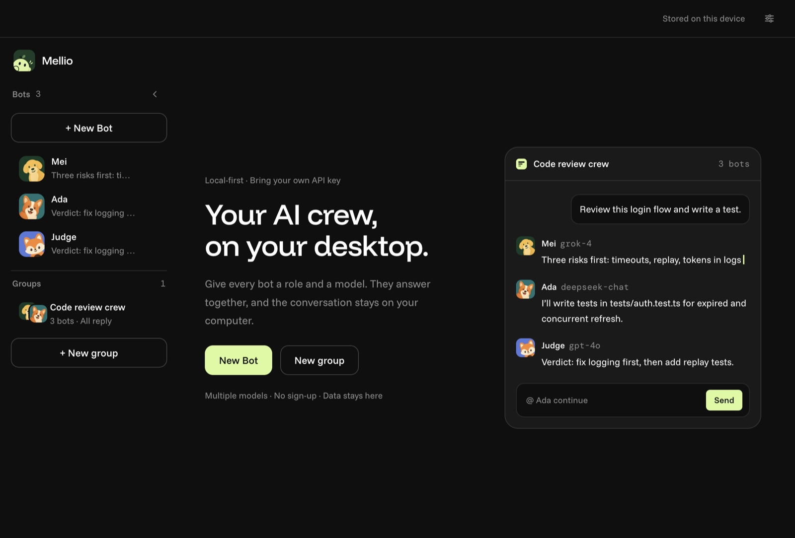
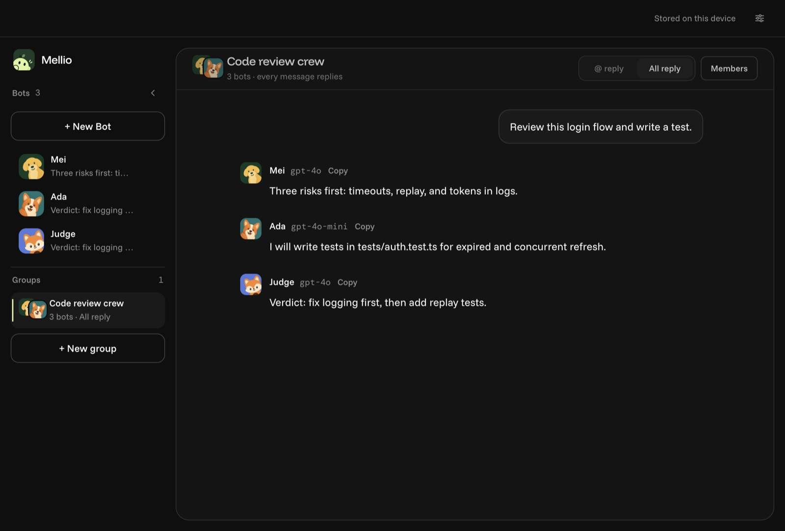
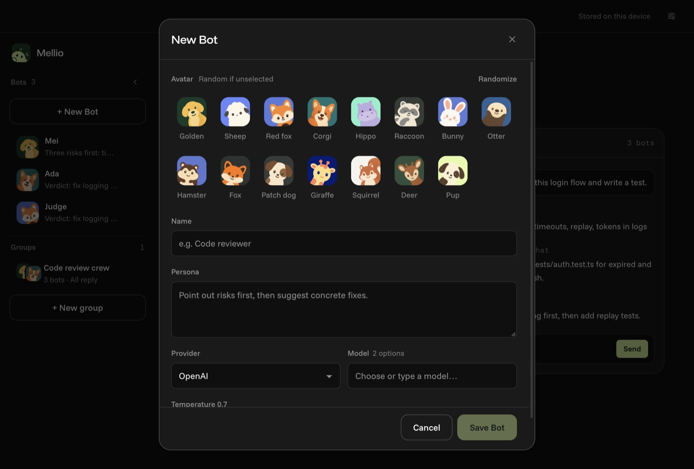
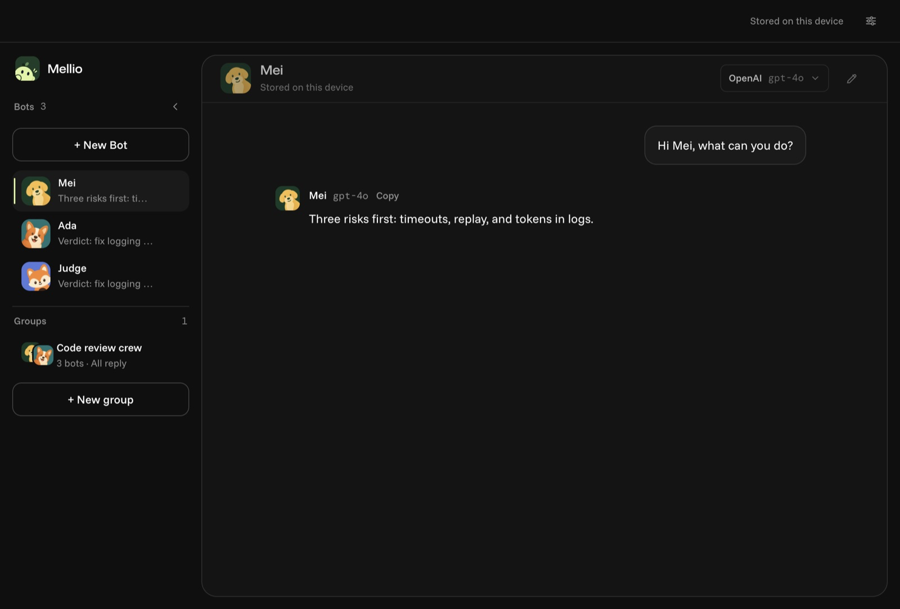

<p align="center">
  
</p>

<h1 align="center">Mellio</h1>

<p align="center"><strong>Your AI crew, your way.</strong><br>Bring your own AI team to your desktop.</p>

<p align="center">
  <code>macOS 11+</code> · <code>Windows 10+</code> · <code>v0.1.0 Beta</code> · <code>Local-first</code> · <code>BYOK</code> · <code>No sign-up</code>
</p>

<p align="center"><strong>English</strong> · <a href="README.zh-CN.md">简体中文</a></p>

Mellio is a local-first desktop workspace for multiple AI bots. Give each bot its own avatar, persona, provider and model, then talk to them one-to-one, put them in a group, or let them think alongside each other. Conversations stay on your machine; model calls use your own API keys.

Mellio does not provide model inference and does not host your data. Requests go to whichever provider you connect.

---

## Contents

- [Features](#features)
- [Screenshots](#screenshots)
- [Install](#install)
- [Quick start](#quick-start)
- [Usage](#usage)
- [Providers and models](#providers-and-models)
- [Your data and privacy](#your-data-and-privacy)
- [Troubleshooting](#troubleshooting)
- [Development](#development)
- [Building and releasing](#building-and-releasing)
- [Known limitations](#known-limitations)
- [Contributing](#contributing)
- [Status and license](#status-and-license)

---

## Features

### A workspace for multiple bots
- Create any number of bots, each with its own avatar, name, persona, provider, model and temperature
- 15 preset avatars; if you don't choose one, a random avatar is assigned on save
- The left rail is your bot roster, not a chat list: click a bot to open its 1:1 conversation
- Each bot row shows its latest message across conversations, truncated with an ellipsis
- The rail collapses to an icon strip and remembers its state

### 1:1 conversations
- Streaming responses, stop at any time, per-bot failures and request timeouts
- Your message appears immediately; you never wait for the model to start before seeing what you sent
- Switch the bot's provider and model from the top-right of the chat, without leaving the conversation
- Copy any finished bot reply to the system clipboard
- Markdown rendering for code blocks, lists and quotes; raw HTML is never rendered

### Group chat
- Put 2 or more bots in a group; members can be changed at any time
- Two reply modes:
  - **All reply**: every message is answered by every bot
  - **@ reply**: only the mentioned bots reply
- Type `@` or use the `@` button to open the mention picker; keyboard ↑ / ↓ / Enter / Esc supported
- Custom group names, or auto-generated from member names
- Parallel replies with independent states (queued / replying / failed / stopped) and individual stop controls

### Model freedom
- Any OpenAI-compatible provider: OpenAI, DeepSeek, xAI (Grok), OpenRouter, Groq, Ollama, LM Studio and more
- **Fetch models** in Settings to cache a provider's `/models` list; create bots and switch models from a list instead of typing IDs
- API keys are encrypted with the system keychain and never leave the machine except in requests to your provider

### Local-first
- SQLite storage with WAL, no account, no cloud, no forced sync
- Old `data.json` files are imported automatically on first launch and kept as `data.json.imported`
- Versioned database migrations; legacy avatar IDs are mapped to the new presets

### Interface
- English and Simplified Chinese UI; switch in Settings → Language, or follow the system language
- GSAP entrance and micro-interactions, with a reduced-motion fallback and a safety pass for background windows
- Custom app icon, a collapsible rail and a consistent dark design system

---

## Screenshots

| Group chat with reply modes | 15 preset avatars, random if unselected |
|---|---|
|  |  |



Screenshots use English; the app ships with a Chinese UI too. See [README.zh-CN.md](README.zh-CN.md) for Chinese screenshots and documentation.

---

## Install

### Requirements

| Platform | Version | Package |
|---|---|---|
| macOS | 11 Big Sur or later | DMG (currently an Apple Silicon / arm64 build) |
| Windows | 10 / 11 x64 | NSIS EXE (built on Windows or CI) |

No Node.js, Python or local service is required at runtime; everything is bundled.

### Where to get it

Download the installer from the project's release page. Local build outputs live in `release/`:

```text
release/Mellio-0.1.0-arm64.dmg
release/Mellio Setup 0.1.0.exe   # built with npm run dist:win on Windows / CI
```

Installers are published as GitHub Releases rather than committed to the repository. See [Building and releasing](#building-and-releasing).

### macOS

1. Open the DMG and drag Mellio into Applications
2. Current builds are **not Apple-notarized**; on first launch either:
   - right-click Mellio in Applications → Open → confirm, or
   - allow it in System Settings → Privacy & Security → Open Anyway
3. If macOS says the app is "damaged" (usually a quarantine/unsigned-build issue) and you trust the download source:

```bash
xattr -dr com.apple.quarantine /Applications/Mellio.app
```

### Windows

1. Run the NSIS installer; it installs per-user and does not need administrator rights
2. Unsigned builds trigger SmartScreen: More info → Run anyway
3. App data lives in `%APPDATA%\Mellio\`

### From source

Requires Node.js 22+ and npm:

```bash
# in the project root
npm install
npm run dev
```

---

## Quick start

1. **Open Mellio.** A new install starts empty — no demo provider, no demo bots.
2. **Add a provider.** Settings → fill in name, Base URL and API key → Save provider.
3. **Fetch models.** Click **Fetch models** on the provider row; the list is cached locally.
4. **Create a bot.** + New Bot: leave the avatar unselected for a random one, set a name and persona, choose a provider and model.
5. **Start chatting.** Click a bot in the rail for a 1:1 chat, or + New group to bring several bots together.
6. **Switch models fast.** The top-right control in a 1:1 chat shows the current provider and model; open it to switch.

---

## Usage

### Bots

- **Create / edit / delete**: + New Bot in the rail; hover a bot row and use the edit button
- **Avatars**: choose one of 15 presets, or leave nothing selected and Mellio assigns a random one; "Randomize" picks one immediately
- **Persona**: written into the system prompt and defines the bot's role, tone and boundaries
- **Temperature**: 0–2, default 0.7; lower is steadier, higher is more varied
- **Saving a new bot** opens its 1:1 conversation automatically
- **Row preview**: each bot row shows the latest message from any conversation it participates in

### 1:1 conversations

- Click any bot in the rail; each bot has a single canonical 1:1 conversation
- Responses stream in; press Stop to cancel while keeping the partial answer
- Every finished bot reply has a Copy action; it briefly shows Copied
- The top-right `Provider · Model` control changes that bot's configuration in place and saves immediately
- A failure in one bot (bad key, rate limit, timeout) does not affect other bots in the same round

### Group chats

- + New group: select at least 2 bots and optionally name the group
- In the group header:
  - **@ reply / All reply**: switch the reply mode
  - **Members**: add or remove members (at least 2 must remain)
- **All reply**: every message is answered by all members
- **@ reply**: only mentioned bots answer; if no bot is mentioned the message is saved and Mellio tells you nobody will reply
- Mention a bot by typing `@` or using the `@` button, then choosing from the panel; ↑↓ to move, Enter to choose, Esc to close
- Mentions match bot **names**; the picker inserts `@name ` with a trailing space

#### How group context is assembled

- Each bot receives its system prompt plus the last 20 messages
- Its own messages appear as assistant messages; other bots' messages are flattened with a `[Name]:` prefix
- Parallel replies in one round do not see each other's live output; they see them in the next round
- Bots never call each other autonomously, which avoids runaway loops and costs

### Model lists

- **Fetch models** on a provider row calls `{Base URL}/models` and caches the result
- The count is shown on the row; create-bot and switch-model fields get the list as suggestions
- Changing a provider's Base URL clears its cached model list
- If a provider does not implement `/models`, or the list is incomplete, you can still type a model ID manually

### Language

- English and Simplified Chinese
- Switch in Settings → Language; the choice is remembered
- On first launch the UI follows the system language (`zh*` → Chinese, otherwise English)

### Layout and keyboard

- Left rail: bot roster and groups; the chevron collapses/expands it
- Click the Mellio mark at the top of the rail to return home
- Top-right: Settings; in a 1:1 chat also the provider/model switcher and the bot editor

| Action | Keys |
|---|---|
| Send | Enter |
| New line | Shift + Enter |
| Move in the @ panel | ↑ / ↓ |
| Choose a mention | Enter |
| Close the @ panel | Esc |
| Close a sheet | Esc |

---

## Providers and models

Mellio needs an **OpenAI-compatible** `/chat/completions` endpoint and, optionally, `/models`.

| Provider | Base URL | Model example |
|---|---|---|
| OpenAI | `https://api.openai.com/v1` | `gpt-4o-mini` |
| DeepSeek | `https://api.deepseek.com/v1` | `deepseek-chat` |
| xAI (Grok) | `https://api.x.ai/v1` | `grok-4` |
| OpenRouter | `https://openrouter.ai/api/v1` | `deepseek/deepseek-chat` |
| Groq | `https://api.groq.com/openai/v1` | `llama-3.3-70b-versatile` |
| Moonshot | `https://api.moonshot.cn/v1` | `moonshot-v1-8k` |
| Ollama (local) | `http://127.0.0.1:11434/v1` | `llama3.1` |
| LM Studio (local) | `http://127.0.0.1:1234/v1` | the model ID loaded locally |

> Model names are examples only. Use **Fetch models** to see what your key can actually access.

### API keys and billing

- Keys are encrypted with the system secure storage (macOS Keychain / Windows DPAPI) and decrypted only in the main process
- Keys never reach the renderer process and are never written to logs
- Model calls go directly from your machine to your provider using your key; you pay the provider
- Mellio does not resell inference and does not provide built-in credits

---

## Your data and privacy

### Where data lives

| Platform | Path |
|---|---|
| macOS | `~/Library/Application Support/Mellio/mellio.db` |
| Windows | `%APPDATA%\Mellio\mellio.db` |

- SQLite + WAL: bots, conversations, messages, provider configuration and model caches
- API keys are stored as ciphertext; decryption relies on the system keychain
- Upgrading from an early build imports `data.json` automatically and renames it to `data.json.imported`

### Backup and restore

Quit Mellio completely, then copy the whole data directory (including `mellio.db` and any `-wal` / `-shm` files). To restore, put the directory back and launch the app.

### Reset

Back up first, then delete the data directory. The next launch creates a fresh database.

### Local-first is not "nothing leaves the machine"

- Conversations are stored locally and are not uploaded to a Mellio server
- When you send a message, the prompt, context and model configuration are sent over HTTP(S) to the provider you configured
- In a group, the context (including other bots' messages) is sent to each participating bot's model
- Evaluate the sensitivity of your content against each provider's privacy policy

### Security design

- Electron `sandbox` + `contextIsolation`; the renderer has no Node access
- Strict CSP in packaged builds; external links are handed to the system browser over HTTPS only
- Model output is rendered as Markdown and never executes raw HTML
- No accounts, cloud sync or telemetry upload and no local HTTP server

---

## Troubleshooting

| Symptom | Likely cause | Fix |
|---|---|---|
| `401` / `403` | Invalid, expired or unauthorized key | Edit the provider in Settings and re-enter the key |
| Fetch models returns `404` | Wrong Base URL, or the provider has no `/models` | Check the `/v1` suffix, or type a model ID manually |
| `429` | Provider rate limit | Reduce concurrency/frequency or check your quota |
| Model not found / invalid model | Model ID does not match the provider | Use **Fetch models** and choose from the list |
| No reply in a group | The group is in **@ reply** mode and no bot was mentioned | Switch to **All reply**, or mention a bot |
| Mentioned a bot but nothing happened | The name did not match | Insert the mention from the @ panel instead of typing it |
| macOS says the developer cannot be verified | Unsigned/unnotarized build | Right-click → Open, or allow it in Privacy & Security |
| Windows SmartScreen blocks the app | Unsigned build | More info → Run anyway |
| App will not open or data looks wrong | Upgrade or corrupted file | Back up the data directory, restart, restore if needed |
| The model list is stale | Base URL changed without refetching | Click **Fetch models** again |

---

## Development

### Requirements

- Node.js 22+
- npm
- macOS 11+ or Windows 10+

### Commands

```bash
npm install          # install dependencies
npm run dev          # development mode (restart after main-process changes)
npm run typecheck    # TypeScript check
npm run check        # self-check: migrations, reply modes, orchestration, cancel, SSE — offline
npm run build        # build to out/
npm run dist:mac     # build a macOS dmg (arm64)
npm run dist:win     # build a Windows NSIS installer (prefer Windows / CI)
```

Set `MELLIO_DATA_DIR=/path/to/dir` to run against an isolated data directory for testing or demos.

### Architecture

```text
┌──────────── renderer (React + zustand, sandbox) ────────────┐
│ UI and presentation state only; no business rules           │
│ calls the main process through window.api (preload)         │
└───────────────────────────┬─────────────────────────────────┘
                            │ IPC: invoke + run:event stream
┌───────────────────────────┴─────────────────────────────────┐
│ main (Node)                                                 │
│ index        windows / menu / IPC / CSP / sender checks     │
│ orchestrator reply modes, @ parsing, context, concurrency   │
│ llm          OpenAI-compatible SSE, model lists             │
│ repo         SQLite (node:sqlite), migrations, JSON import  │
│ secrets      safeStorage encryption                         │
└─────────────────────────────────────────────────────────────┘
```

- Business rules live only in the main process; the renderer does not decide who replies or how context is trimmed
- Streaming is a one-way `run:event` stream, keyed by `runId`
- SQLite uses WAL; `PRAGMA user_version` drives schema migrations
- Main has no third-party runtime dependencies, keeping packaging and startup predictable

### Layout

```text
src/main/        index · orchestrator · llm · repo · secrets
src/preload/     contextBridge API
src/renderer/    App · ChatView · GroupSheet · BotModal · Settings · Avatar · Sheet · motion · i18n · styles.css
src/renderer/assets/avatars/   15 preset avatars (320px JPEG)
shared/          types.ts (contract) · avatars.ts (avatar IDs/labels)
scripts/         selfcheck
docs/            MVP plan and screenshots
build/           icon.png (app icon)
```

### Database

| Table | Purpose |
|---|---|
| `provider` | Provider, Base URL, encrypted key, cached model list |
| `bot` | Name, avatar, persona, provider, model, temperature |
| `conversation` | Title, kind (dm/group), reply mode |
| `conversation_bot` | Member list and order |
| `message` | Content, author, status, run ID, error |

Schema version is 2; v1 → v2 adds `provider.models_json`.

### Tests

`npm run check` covers:

- Legacy `data.json` → SQLite import
- Target resolution for **All reply** and **@ reply**
- Parallel bots and per-bot failure isolation
- Cancel while preserving partial output
- OpenAI SSE parsing
- Legacy JSON import and avatar assignment

### Extending

- **New OpenAI-compatible provider**: add it in Settings; no code change
- **Non-compatible provider**: add an adapter branch in `src/main/llm.ts`; orchestration stays untouched
- **New avatar**: drop `<id>.jpg` into `src/renderer/assets/avatars/` and add metadata in `shared/avatars.ts`

### Design system

The UI uses a custom CSS design system (soot + pale lime monochrome palette, Funnel Display / Funnel Sans / DM Mono, soft radii, shared motion tokens), GSAP motion with a reduced-motion fallback, and a safety pass so entrance animations cannot leave controls invisible in a background window.

---

## Building and releasing

electron-builder produces:

- macOS: DMG, arm64; icon from `build/icon.png`
- Windows: NSIS, per-user install, no administrator rights

Before public distribution:

1. **macOS signing and notarization**: Apple Developer Program, Developer ID Application certificate, electron-builder notarize configuration
2. **Windows code signing**: OV/EV certificate or Azure Trusted Signing
3. **CI**: the included `.github/workflows/release.yml` builds macOS and Windows in a matrix
4. **Auto-update**: not integrated yet (electron-updater)
5. **Versioning**: the `version` in `package.json` appears in the artifact filename

### Publishing installers

Installers are **not committed** to git. The macOS dmg is ~115 MB, above GitHub's 100 MB per-file limit, and binaries do not belong in source history. Publish them through GitHub Releases:

1. Update `version` in `package.json`
2. Commit and push a tag: `git tag v0.1.0 && git push origin v0.1.0`
3. `.github/workflows/release.yml` builds on macOS and Windows and creates a **draft GitHub Release** with the dmg and exe
4. Review and publish the release from the GitHub Releases page

`workflow_dispatch` can run the build manually and produce workflow artifacts without creating a release. See `release/README.md`.

Current dmg builds use a local Apple Development certificate and are **not notarized**; they are intended for internal testing or trusted distribution.

---

## Known limitations

- **Beta**: v0.1.0; interfaces and data structures may change; back up before upgrades
- **Platforms**: macOS arm64 only; the Windows installer must be built on Windows/CI; no Linux
- **Signing**: macOS builds use a local development certificate and are not notarized; Windows builds are unsigned
- **No auto-update**
- **Group management**: members can be edited, but groups cannot yet be renamed or deleted
- **Messages**: no attachments, images or voice
- **Agents**: no tool calling, MCP or knowledge base
- **Conversation tools**: no full-text search, export or cloud sync
- **Context**: groups use the last 20 messages; longer conversations are truncated
- **Model lists**: depend on the provider's `/models`; otherwise enter IDs manually
- **Single window**: no tray or multi-window support

---

## Contributing

- Include the OS version, Mellio version, reproduction steps and any error text in issues
- Remove API keys, conversation content and other sensitive data from logs and screenshots
- Run `npm run typecheck` and `npm run check` before opening a PR

---

## Status and license

- Version: **0.1.0 Beta**
- License: **TBD** — the repository does not include a LICENSE file yet; until one is added, do not treat the project as licensed for redistribution or commercial use
- Third-party components: Electron and React (MIT); GSAP (GreenSock standard license); Funnel Display / Funnel Sans / DM Mono (SIL Open Font License, distributed via Fontsource); react-markdown (MIT)

---

<p align="center"><sub>Mellio · Your AI crew, your way.</sub></p>
